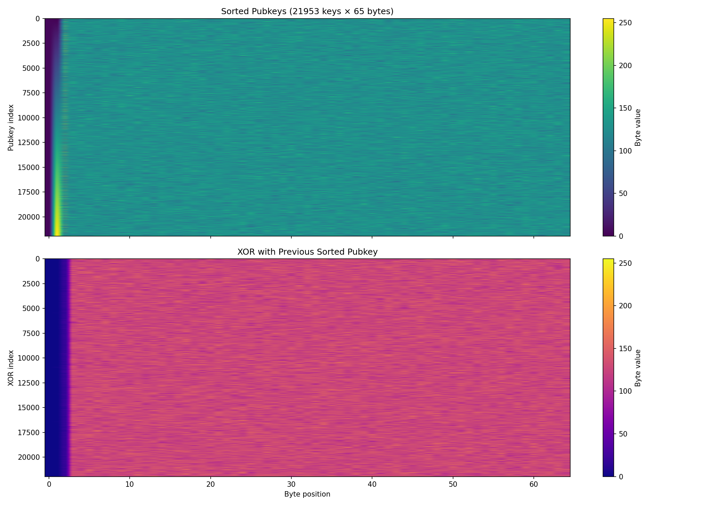
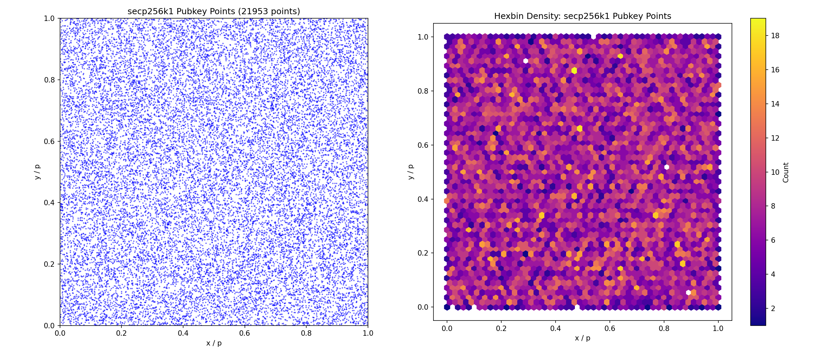
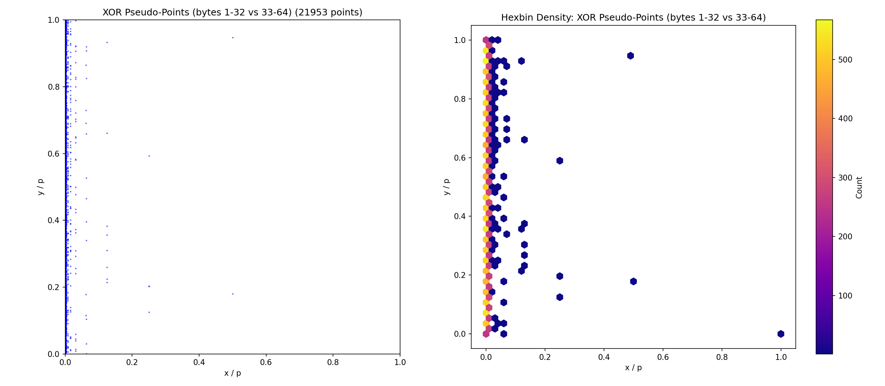
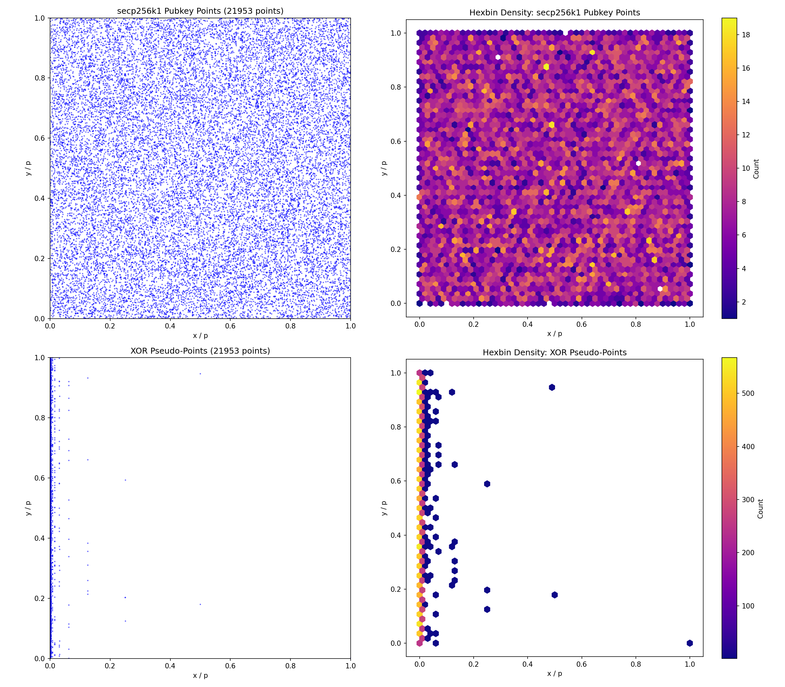

# Patoshi Addresses

Complete dataset of 21,953 Bitcoin blocks suspected to have been mined by Satoshi Nakamoto, with their public keys.

### patoshi\_addresses\_sorted\_stripped\_xor.png



### patoshi\_addresses\_sorted\_stripped\_xor\_curve.png



### patoshi\_addresses\_sorted\_stripped\_xor\_xor\_curve.png



### patoshi\_addresses\_sorted\_stripped\_xor\_curve\_combined.png



## Credits

Based on the work of:
- **Sergio Demian Lerner** ([@SDLerner](https://github.com/SDLerner)) - Discovered the Patoshi pattern
- **Jameson Lopp** ([@jlopp](https://github.com/jlopp)) - Curated the Patoshi blocks dataset

## Dataset

- **Blocks**: 21,953 (blocks 3-49,973)
- **Total BTC**: 1,097,650 BTC
- **Format**: CSV with columns: Block Height, Output Index, Address/Pubkey, Amount (BTC), Script Type

## Setup

The repository includes a `run` script that creates a virtual environment, installs `requests`, and executes the extractor. Use it for convenience:

```bash
./run --logging INFO
```

To set up manually:

```bash
python3 -m venv venv
source venv/bin/activate
pip install requests matplotlib numpy
```

`requests` is required by `extract_patoshi_addresses.py`. `matplotlib` and `numpy` are only needed for `plot_patoshi_xor.py`.

## Usage

```bash
# Generate the dataset
python3 extract_patoshi_addresses.py

# Resume after an interruption
python3 extract_patoshi_addresses.py --resume

# Control logging level (DEBUG, INFO, WARNING, ERROR, CRITICAL)
python3 extract_patoshi_addresses.py --logging INFO
python3 extract_patoshi_addresses.py --logging DEBUG

# Sort output rows by public key/address before finishing
python3 extract_patoshi_addresses.py --sort

# Write only the Address/Pubkey values, one per line
python3 extract_patoshi_addresses.py --stripped

# Sort and write only the Address/Pubkey values, one per line
python3 extract_patoshi_addresses.py --sort --stripped

# Append XOR with the previous sorted pubkey (requires --sort and --stripped)
python3 extract_patoshi_addresses.py --sort --stripped --xor

# Resume a variant run; patoshi_addresses.csv is seeded into the variant file first
python3 extract_patoshi_addresses.py --sort --resume
python3 extract_patoshi_addresses.py --sort --stripped --xor --resume

# View the data
head patoshi_addresses_sorted_stripped_xor.csv
```

### Plotting

```bash
# Byte heatmap of pubkeys and XOR differences
python3 plot_patoshi_xor.py patoshi_addresses_sorted_stripped_xor.csv

# Pubkey points on the secp256k1 curve
python3 plot_patoshi_xor.py --mode curve patoshi_addresses_sorted_stripped_xor.csv

# XOR values plotted as pseudo (x, y) points
python3 plot_patoshi_xor.py --mode xor-curve patoshi_addresses_sorted_stripped_xor.csv

# Both curve views in one figure
python3 plot_patoshi_xor.py --mode curve-combined patoshi_addresses_sorted_stripped_xor.csv
```

## Files

- `patoshi_pubkeys_COMPLETE.csv` - The complete dataset
- `patoshi_addresses.csv` - Default full output with columns: Block Height, Output Index, Address/Pubkey, Amount (BTC), Script Type
- `patoshi_addresses_sorted.csv` - Sorted output generated when `--sort` is used
- `patoshi_addresses_stripped.csv` - One Address/Pubkey value per line generated when `--stripped` is used
- `patoshi_addresses_sorted_stripped.csv` - One Address/Pubkey value per line generated when `--sort --stripped` is used
- `patoshi_addresses_sorted_stripped_xor.csv` - Sorted stripped output with an extra XOR column generated when `--sort --stripped --xor` is used
- `<output>.resume.json` - Resume checkpoint created when `--resume` is used
- `extract_patoshi_addresses.py` - Script to generate the dataset from block numbers; commits every file write to git when run inside a git repo
- `plot_patoshi_xor.py` - Script to visualize pubkeys and XOR differences
- `README.md` - This file

Block lookups try mempool.space first and bitcoin.gob.sv as a fallback.